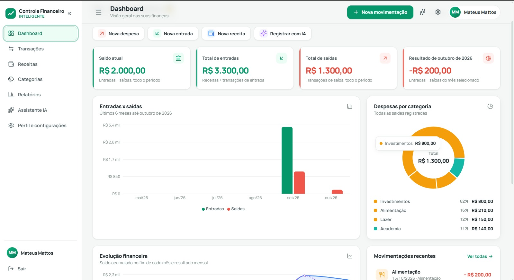
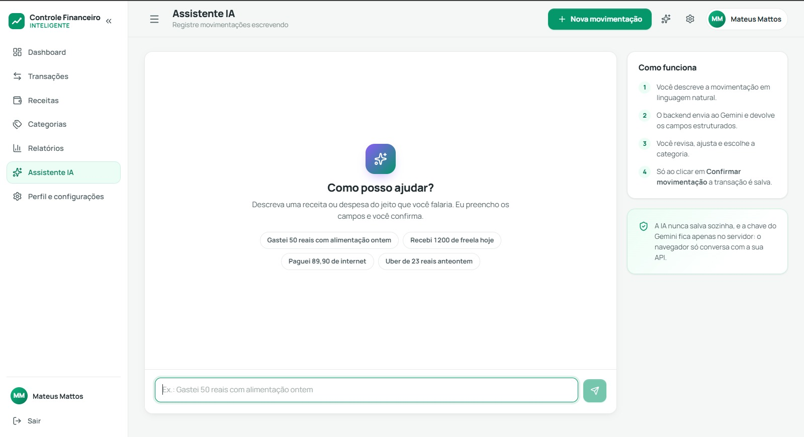
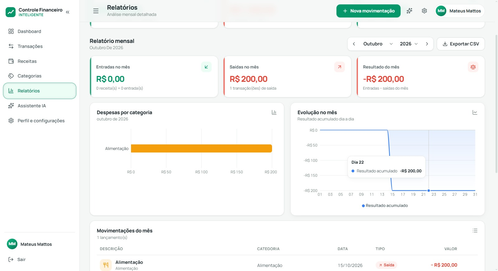
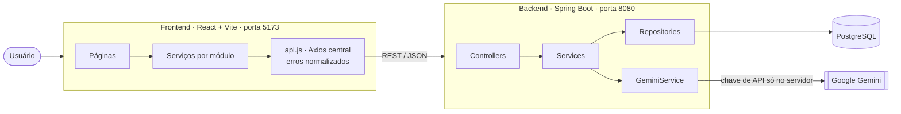
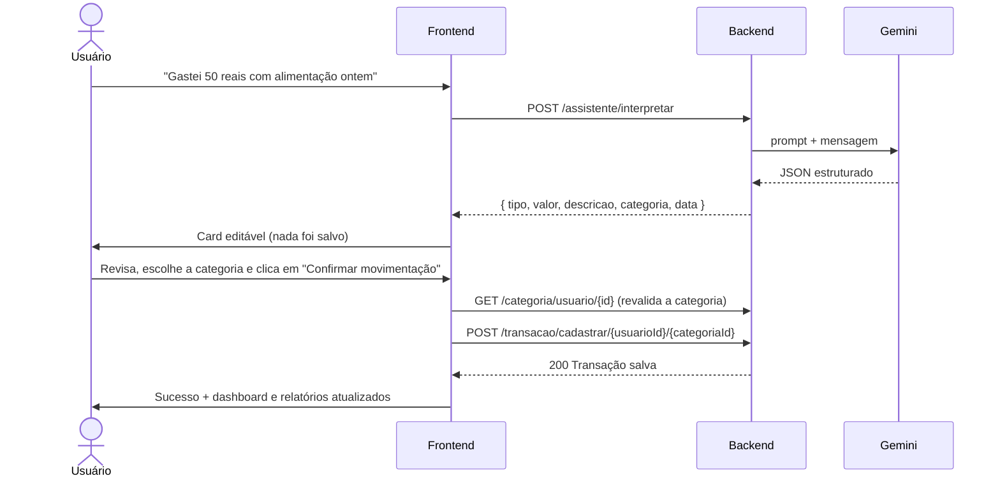

<div align="center">

#  Controle Financeiro Inteligente — Frontend

**Aplicação web de finanças pessoais com assistente de IA que transforma frases em lançamentos.**

React · Vite · Axios · Recharts · Framer Motion — integrada a uma API REST em Java + Spring Boot + PostgreSQL


[Sobre](#-sobre-o-projeto) ·
[Funcionalidades](#-funcionalidades) ·
[Arquitetura](#%EF%B8%8F-arquitetura) ·
[Como rodar](#-como-rodar-o-projeto) ·
[Decisões técnicas](#-decisões-técnicas) ·
[Próximos passos](#-próximos-passos)

</div>

---

##  Sobre o projeto

O **Controle Financeiro Inteligente** é um sistema completo de finanças pessoais que desenvolvi de ponta a ponta:
primeiro o [backend em Spring Boot](https://github.com/mtmattoz/Controle-Financeiro-Backend) e depois este frontend em React.

O usuário registra receitas e despesas, organiza tudo em categorias e acompanha a saúde financeira em um dashboard com gráficos.
O diferencial é o **assistente com IA**: em vez de preencher formulários, a pessoa escreve algo como

> *"Gastei 50 reais com alimentação ontem"*

e o sistema identifica o tipo, o valor, a descrição, a categoria e a data. O usuário revisa um card editável, ajusta o que quiser e
**só então confirma**. A IA nunca grava nada sozinha.

### O que este projeto demonstra

- **Integração real com uma API REST**: todas as telas consomem os endpoints existentes. Nenhum dado é fictício e nenhuma rota foi inventada.
- **Leitura de contrato antes de codar**: mapeei controllers, entidades, DTOs e tratamento de erros do backend em um [inventário de endpoints](docs/API_ENDPOINTS.md).
- **IA aplicada com responsabilidade**: o humano fica no controle (*human-in-the-loop*), a resposta da IA é validada e a chave da API nunca chega ao navegador.
- **Experiência de produto**: estados de carregamento (skeletons), erro e vazio em todas as telas, validação de formulários, confirmação de ações destrutivas e feedback visual.
- **Código organizado e manutenível**: serviços por módulo, contextos, hooks reutilizáveis e CSS separado por área.

---

##  Funcionalidades

| Área | O que faz |
|---|---|
|  **Login e cadastro** | Criação de conta e login com validação no front espelhando as regras do backend (senha ≥ 6, nome único) e mensagens de erro claras. |
|  **Dashboard** | Saldo atual, total de entradas e saídas, resultado do mês selecionado, gráfico de entradas × saídas dos últimos 6 meses, evolução do saldo acumulado, despesas por categoria (rosca) e movimentações recentes. |
|  **Transações** | Cadastro de entradas e saídas com categoria, filtros por tipo e categoria (usando as rotas da API), busca por descrição, filtro por período e exclusão com confirmação. |
|  **Receitas** | Registro de receitas (salário, freelas…), totais do mês e geral, busca e filtro por mês. |
|  **Categorias** | Criação e exclusão, ícone e cor automáticos pelo nome, e estatísticas de uso (quantidade e valores por categoria). |
|  **Relatórios** | Bloco acumulado (calculado pelo backend), relatório mensal com despesas por categoria, evolução dia a dia, tabela detalhada e **exportação CSV**. |
|  **Assistente IA** | Conversa em linguagem natural → card de confirmação editável → salvamento só após clique explícito. Se a IA sugerir uma categoria que não existe, o usuário escolhe outra ou cria essa com um clique. |
|  **Perfil e configurações** | Dados da conta, teste de conexão com a API e transparência sobre as limitações de segurança atuais do backend. |

**Experiência:** layout responsivo (sidebar recolhível no desktop e menu lateral no celular), tema claro com identidade em verde esmeralda,
animações discretas com Framer Motion (respeitando `prefers-reduced-motion`), valores em R$ e datas no padrão brasileiro.


 PRINTS DAS TELAS
Salve capturas em docs/screenshots/ com estes nomes e remova este comentário para exibi-las:

<p align="center">
  
</p>
<p align="center">
  
  
</p>


---

##  Arquitetura



**Fluxo do assistente de IA**



---

##  Tecnologias

| Camada | Tecnologias |
|---|---|
| **Frontend** | React 19, Vite, JavaScript, React Router DOM, Axios, Recharts, Framer Motion, Lucide React, Context API, CSS com variáveis |
| **Backend** ([repositório](https://github.com/mtmattoz/Controle-Financeiro-Backend)) | Java 17, Spring Boot, Spring Data JPA, Bean Validation, PostgreSQL, Lombok, BCrypt, Google Gemini API |

Não usei frameworks de UI prontos: o design system (cores, cards, formulários, modais, toasts, skeletons) foi escrito em CSS próprio.

---

##  Estrutura de pastas

O código é separado por responsabilidade. HTML, CSS e JavaScript ficam em lugares diferentes, e cada pasta tem um papel claro:

```text
controle-financeiro-frontend/
├── index.html                  # HTML base (o Vite exige que fique na raiz)
├── public/                     # Arquivos estáticos (favicon)
├── docs/
│   └── API_ENDPOINTS.md        # Inventário completo dos endpoints e contratos
├── .env.example                # Modelo da variável VITE_API_URL
└── src/
    ├── main.jsx                # Ponto de entrada: monta o React e importa os CSS
    ├── App.jsx                 # Rotas da aplicação
    │
    ├── pages/                  # Uma página por rota
    │   ├── Login.jsx · Cadastro.jsx · Dashboard.jsx · Transacoes.jsx · Receitas.jsx
    │   └── Categorias.jsx · Relatorios.jsx · Assistente.jsx · Configuracoes.jsx
    │
    ├── components/             # Componentes reutilizáveis
    │   ├── layout/             # Sidebar, cabeçalho, layout, rotas protegidas
    │   ├── ui/                 # Botões, modal, cards, estados de carregamento/erro/vazio
    │   ├── forms/              # Formulários e validações
    │   ├── charts/             # Gráficos (Recharts)
    │   ├── movimentacoes/      # Lista de transações e receitas
    │   └── assistente/         # Card de confirmação da IA
    │
    ├── services/               # Comunicação com a API (único lugar que usa Axios)
    │   ├── api.js              # Cliente central, tratamento de erros, validação de respostas
    │   ├── authService.js · categoriaService.js · transacaoService.js
    │   └── receitaService.js · relatorioService.js · assistenteService.js
    │
    ├── contexts/               # Estado global: sessão, notificações, atualização de dados
    ├── hooks/                  # useApiData (carregamento), useExclusao (fluxo de exclusão)
    ├── utils/                  # Formatação BRL/datas, cálculos financeiros, exportação CSV
    │
    └── styles/                 # TODO o CSS da aplicação
        ├── base.css            # Variáveis (cores, fontes, sombras) e reset
        ├── layout.css          # Sidebar, cabeçalho e grade da página
        ├── components.css      # Botões, formulários, cards, modais, listas, toasts
        ├── charts.css          # Tooltip e gráfico de rosca
        └── pages/              # Um arquivo CSS por página
```

---

##  Como rodar o projeto

### Pré-requisitos

- **Node.js 18+** e npm
- **Java 17+**, **PostgreSQL** e uma **chave da API do Google Gemini** (para o backend)

### 1. Backend (API Spring Boot)

```bash
git clone https://github.com/mtmattoz/Controle-Financeiro-Backend.git
cd Controle-Financeiro-Backend
```

Crie o banco no PostgreSQL:

```sql
CREATE DATABASE controle_financeiro;
```

Defina as variáveis de ambiente usadas no `application.properties` e suba a API:

```bash
# Linux / macOS
export DB_PASSWORD="sua_senha_do_postgres"
export GEMINI_API_KEY="sua_chave_do_gemini"
./mvnw spring-boot:run
```

```powershell
# Windows (PowerShell)
$env:DB_PASSWORD="sua_senha_do_postgres"
$env:GEMINI_API_KEY="sua_chave_do_gemini"
.\mvnw.cmd spring-boot:run
```

A API sobe em `http://localhost:8080`. As tabelas são criadas automaticamente (`ddl-auto=update`).

### 2. Frontend (este repositório)

```bash
git clone <url-deste-repositorio>
cd controle-financeiro-frontend

cp .env.example .env.local   # no Windows: copy .env.example .env.local
npm install
npm run dev
```

Acesse **http://localhost:5173**, crie uma conta e comece a registrar suas movimentações.

>  **Use a porta 5173.** O backend só libera requisições (CORS) dessa origem. O projeto já está configurado para não trocar de porta.

### Variáveis de ambiente

| Variável | Padrão | Descrição |
|---|---|---|
| `VITE_API_URL` | `http://localhost:8080` | Endereço da API. Defina em `.env.local` se o backend rodar em outro lugar. |

### Scripts

| Comando | Descrição |
|---|---|
| `npm run dev` | Servidor de desenvolvimento em `localhost:5173` |
| `npm run build` | Build de produção em `dist/` |
| `npm run preview` | Serve o build de produção localmente |

### Roteiro rápido para testar

1. Crie uma conta e vá em **Categorias** → crie "Alimentação" e "Transporte".
2. Clique em **Nova movimentação** → registre uma despesa e, na aba *Receita*, um salário.
3. Veja o **Dashboard** e os **Relatórios** se atualizarem.
4. No **Assistente IA**, escreva *"Gastei 50 reais com alimentação ontem"*, revise o card e confirme.
5. Tente excluir uma categoria que tem transações: o sistema explica por que não é possível.

---

##  Decisões técnicas

**Contrato primeiro, tela depois.** Antes de escrever componentes, li todos os controllers, entidades e o `GlobalExceptionHandler` do backend
e documentei cada rota em [`docs/API_ENDPOINTS.md`](docs/API_ENDPOINTS.md). Por exemplo: receita e transação têm contratos diferentes
(receita não tem categoria nem tipo), e o login usa `@RequestParam`. Por isso as credenciais são enviadas como formulário no corpo, e não na URL.

**Uma camada de API, um formato de erro.** O backend responde erros de três jeitos: texto puro (401/403/404), mapa `{ campo: mensagem }` (400)
e o corpo padrão do Spring (500). O `api.js` normaliza tudo em um `ApiError`. Assim as telas mostram a mensagem do servidor quando existe e uma
explicação de contexto quando não existe (ex.: *"esse nome de usuário provavelmente já está em uso"*).

**Números financeiros consistentes.** O dashboard usa a mesma regra do backend (`entradas = receitas + transações de entrada`) e nunca mistura
períodos: valores acumulados e valores do mês aparecem em indicadores separados e identificados.

**IA com o humano no controle.** O endpoint de interpretação não grava nada. O front valida a resposta da IA, pré-seleciona a categoria só se ela
existir de fato, revalida a categoria no servidor no momento de salvar e mostra sucesso apenas após a confirmação da API.

**Atualização sem recarregar a página.** Um contexto de "versão dos dados" faz todas as telas abertas buscarem dados novos após qualquer cadastro
ou exclusão confirmados. Requisições GET idênticas e simultâneas são deduplicadas.

**Acessibilidade e movimento.** Rótulos ligados aos campos, `aria-invalid` nos erros, foco gerenciado nos modais, navegação por teclado e
animações desativadas para quem usa `prefers-reduced-motion`.

---

##  Próximos passos

Pontos que identifiquei durante a integração e que estão no meu roadmap:

- [ ] **Autenticação com Spring Security + JWT.** Hoje o login valida a senha, mas as rotas recebem o `usuarioId` pela URL, sem token.
      O front já está preparado: basta adicionar o header `Authorization` no `api.js`.
- [ ] **Edição de registros (PUT)** para transações, receitas e categorias. Hoje é possível criar e excluir.
- [ ] **Tratamento de erros no backend** para nome de usuário duplicado e categoria com transações vinculadas (hoje retornam 500 genérico).
- [ ] **Endpoints com filtros e paginação** (receitas por mês, tipo + categoria, intervalo de datas).
- [ ] **Testes automatizados** (Vitest + Testing Library) e deploy (front na Vercel, API no Render/Railway).

---

##  Autor

**Mateus de Mattos Villar**

[](https://github.com/mtmattoz)
[](https://www.linkedin.com/in/mateusdemattos)

Se este projeto foi útil ou interessante para você, deixe uma ⭐ no repositório!
